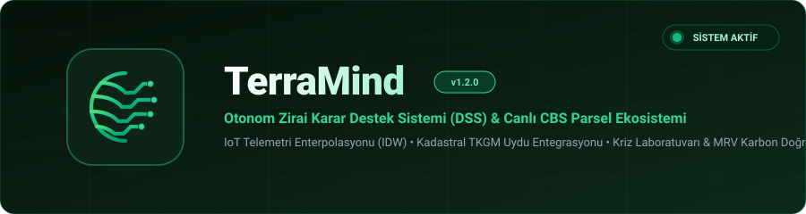
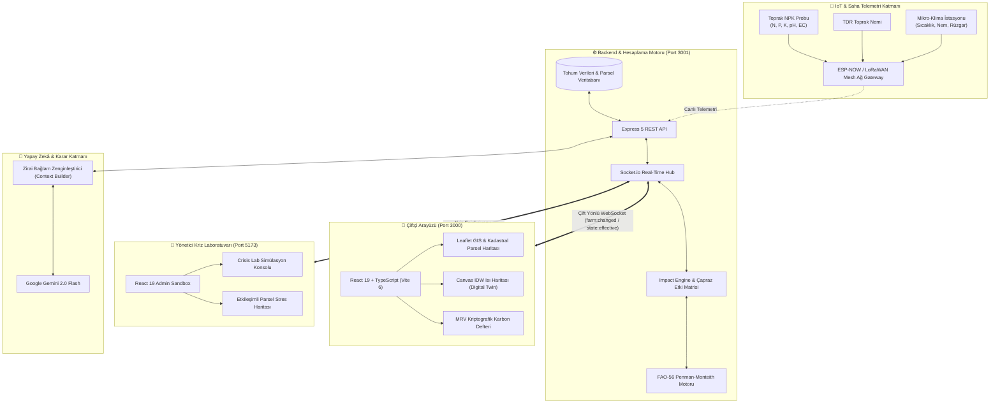

<p align="center">
  
</p>

<p align="center">
  <strong>Toprağı anlayan, veriden öğrenen ve çiftçinin saha sezgilerini otonom yapay zekâ ile buluşturan yeni nesil Zirai Karar Destek (DSS) ve Parsel Yönetim Ekosistemi.</strong>
</p>

<p align="center">
  <a href="https://react.dev/"></a>
  <a href="https://www.typescriptlang.org/"></a>
  <a href="https://vitejs.dev/"></a>
  <a href="https://tailwindcss.com/"></a>
  <a href="https://nodejs.org/"></a>
  <a href="https://expressjs.com/"></a>
  <a href="https://socket.io/"></a>
  <a href="https://leafletjs.com/"></a>
  <a href="https://ai.google.dev/"></a>
  <a href="#lisans"></a>
</p>

<p align="center">
  <a href="#-hızlı-başlangıç--kurulum"><b>🚀 Hemen Başlat</b></a> •
  <a href="#-temel-özellikler--modüller"><b>✨ Temel Özellikler</b></a> •
  <a href="#-sistem-mimarisi"><b>🏛️ Mimari Tasarım</b></a> •
  <a href="#-yönetici-kriz-laboratuvarı-crisis-lab"><b>🧪 Kriz Laboratuvarı</b></a> •
  <a href="#-tohum-verileri--saha-senaryoları"><b>🌱 Saha Tohum Verileri</b></a> •
  <a href="#-katkıda-bulunma--takım"><b>👥 Takım & Lisans</b></a>
</p>

---

## 📌 TerraMind Nedir?

**TerraMind**, geleneksel alışkanlıklara ve tahminlere dayalı tarımsal üretim süreçlerini; **IoT sensör telemetrisi**, **bölgesel CBS (Coğrafi Bilgi Sistemleri)** ve **büyük dil modelleri (LLM)** ile desteklenen otonom bir mühendislik platformuna dönüştüren açık uçlu akıllı tarım ekosistemidir.

Tarım arazilerini sadece pasif grafiklerle izlemek yerine; toprak nemi, NPK dengesi, evaporasyon kayıpları ve uydu NDVI indekslerini anlık işler. Sulama vanalarını otonom denetler, erken ilkbahar donu ve fungal salgınları (Monilya, Külleme, Pas) önceden haber verir, doğrulanabilir **MRV (Measurement, Reporting, Verification)** karbon kaydı tutar ve çiftçiyi en uygun devlet hibelerine (IPARD / KKYDP) yönlendirir.

> [!IMPORTANT]
> **Çiftçi Odaklı Sade Arayüz & İzole Yönetici Kriz Merkezi:**
> TerraMind'da son kullanıcı (çiftçi) ekranı karmaşık grafik yığınlarından arındırılmış, 3 saniyede tarlanın durumunu kavrayıp eyleme geçebileceği bir bilgi mimarisine sahiptir. Gelişmiş simülasyon parametreleri, stres testleri ve NPK manipülasyonları ise yalnızca **Yönetici Kriz Laboratuvarı'nda (Crisis Lab)** barındırılır.

---

## ✨ Temel Özellikler & Modüller

### 1. 🧠 Otonom Zirai Karar Destek Sistemi (DSS & Gemini 2.0 Flash)
- **Bağlamsal Analiz:** Gemini 2.0 Flash modeli, sahadaki anlık sensör değerleri (Nem, Sıcaklık, EC, pH, Azot), geçmiş 7 günlük eğilimler ve canlı hava durumu tahminleriyle harmanlanmış zenginleştirilmiş istemlerle (prompting) çalışır.
- **Aksiyon Odaklı Tavsiyeler:** Çiftçiye anlaşılmaz ham istatistikler yerine net direktifler sunar: *"Bu gece 03:00'te don riski (-3°C) bekleniyor; damlama hattını korumaya alın ve çiçeklenme koruyucu fungisit uygulamasını başlatın."*
- **FAO-56 Evapotranspirasyon Hesaplayıcısı:** Penman-Monteith referans denklemine dayalı toprak su açığı ve bitki katsayısı ($K_c$) analizi.

### 2. 🗺️ Kadastral CBS & Uydu Tabanlı Parselizasyon (TKGM Standartlarında)
- **Esri World Imagery & Leaflet Entegrasyonu:** Tarlanın gerçek uydu dokusu üzerinde sınır çizimi, poligon alan ve dönüm hesaplaması (Turf.js).
- **Parsel / Blok Bazlı İzleme:** Tarlayı alt parsellere (Güneş Sekisi, Vadi Çukuru, Pompa Hattı, Genç Fidanlık) bölerek tehlike durumunu parsel düzeyinde renklendirme (`NORMAL`, `WARNING`, `CRITICAL`).
- **3 Büyük Üretim Havzası:** Manisa (Bağcılık), Malatya (Kayısı) ve Kayseri (Buğday / Tahıl) için gerçek TKGM koordinatlarına sahip poligon modelleri.

### 3. 🌡️ IDW Algoritmalı Dijital İkiz (Digital Twin Heatmap)
- **Inverse Distance Weighting (Ters Mesafe Ağırlıklı Enterpolasyon):** Sensör noktalarından gelen telemetriyi statik renk kutuları yerine, HTML5 Canvas üzerinde piksel piksel enterpole ederek gerçekçi mikro-klima ve nem dağılım haritası oluşturur.
- **Canlı Titreşim & Dinamik Akış:** Sensör düğümlerindeki anlık salınımlar pürüzsüz gradient geçişleriyle görselleştirilir.

### 4. 🧪 Yönetici Saha Kriz Simülasyon Merkezi (Crisis Lab)
- **Yetkilendirme İzolasyonu (`role === 'admin'`):** Çiftçi arayüzünden tamamen tecrit edilmiş, sadece yetkili araştırmacı ve ziraat mühendislerinin erişebildiği laboratuvar paneli.
- **Çok Değişkenli Stres Testleri:**
  - 💧 **Sulama Altyapı Çöküşü:** Pompa arızası ve damlatıcı tıkanıklığı simülasyonu.
  - ❄️ **Ani İlkbahar Donu:** Gece -4°C ani sıcaklık düşüşü ve vejetatif doku şoku.
  - 🍂 **Fungal Salgın Simülatörü:** Monilya, Bağ Küllemesi, Buğday Sarı Pası ve Kök Çürüklüğü yayılım dinamikleri.
  - 🧪 **Aşırı Gübreleme & Tuzluluk:** Yüksek NPK (Azot > 200 ppm, EC > 4.5 mS/cm) yanıklık ve pH stresi.
- **Socket.io Çift Yönlü Canlı Köprü:** Simülatörde tetiklenen bir kriz parametresi anında backend ve çiftçi arayüzündeki sensör ekranlarına anlık telemetri olarak yansır.

### 5. 📜 Doğrulanabilir Karbon MRV Defteri & Hibe Eşleştirici
- **Kriptografik Bütünlük (FNV-1a Hash Zinciri):** Her sulama ertelemesi ve enerji tasarrufu olayı, bir önceki bloğun özetini referans alan hafif blokzincir benzeri zincirde mühürlenir. "Zincir Doğrula" motoru sahteciliği anında engeller.
- **Gerçek Devlet Destekleri Eşleştirmesi:** Çiftliğin doğrulanmış tasarruf skoruna göre **IPARD III (TKDK)** ve **KKYDP Kırsal Kalkınma Akıllı Tarım Hibe Programları** ile otomatik eşleşme ve tahmini hibe (₺) simülasyonu.

---

## 📸 Görsel Önizleme & Ekranlar

<div align="center">
  <table>
    <tr>
      <td width="50%" align="center">
        <b>📱 Çiftçi Mobil Dashboard & Saha Haritası</b><br/><br/>
        
        <p align="left"><i>Sadeleştirilmiş gösterge paneli, canlı NPK/nem göstergeleri ve tek tıkla otonom sulama emri.</i></p>
      </td>
      <td width="50%" align="center">
        <b>🧪 Yönetici Kriz Simülasyon Merkezi (Crisis Lab)</b><br/><br/>
        
        <p align="left"><i>Gerçek zamanlı NPK kaydırıcıları, vana arıza enjektörleri ve don/kuraklık simülasyon haritası.</i></p>
      </td>
    </tr>
    <tr>
      <td width="50%" align="center">
        <b>🛰️ CBS & Kadastral Uydu Parselizasyonu</b><br/><br/>
        
        <p align="left"><i>Esri World Imagery altlığı, Turf.js dönüm hesabı ve alt parsel sınır çizgileri.</i></p>
      </td>
      <td width="50%" align="center">
        <b>📊 IDW Dijital İkiz & MRV Karbon Zinciri</b><br/><br/>
        
        <p align="left"><i>Ters mesafe ağırlıklı enterpolasyonlu ısı haritası ve kriptografik tasarruf defteri.</i></p>
      </td>
    </tr>
  </table>
</div>

---

## 🏛️ Sistem Mimarisi

TerraMind ekosistemi mikro-hizmet mantığıyla ayrılmış 3 ana katmandan oluşur:



---

## 🛠️ Teknoloji Yığını (Tech Stack)

| Katman | Teknoloji / Kütüphane | Sürüm | Görev / Kullanım Alanı |
|---|---|---|---|
| **Frontend (Çiftçi)** | React + TypeScript | `v19.0` / `v5.8` | Mobil öncelikli duyarlı kullanıcı arayüzü ve bileşen mimarisi |
| **Frontend Yapı Aracı** | Vite | `v6.2` | Lightning-fast HMR ve optimize üretim derleyicisi |
| **Stil & Tasarım** | Tailwind CSS (v4) + Lucide | `v4.0` / `v0.54` | Modern yeşil/tarımsal renk paleti, cam efektleri ve minimalist ikonografi |
| **Harita & CBS** | Leaflet + React-Leaflet | `v1.9` / `v5.0` | Esri World Imagery uydu altlığı ve kadastro parselizasyonu |
| **Mekânsal Hesaplama** | Turf.js (`@turf/area`) | `v7.4` | Parsel köşe noktalarından hassas m² ve dönüm hesaplama motoru |
| **Grafik & Veri** | Recharts + HTML5 Canvas | `v3.10` | 7 günlük telemetri trendleri ve özel IDW ısı haritası render motoru |
| **Backend API** | Node.js + Express | `v18+` / `v5.2` | RESTful servisler, tarla seçim API'leri ve CORS yönlendirmesi |
| **Gerçek Zamanlı İletişim**| Socket.io | `v4.8` | Admin kriz simülatörü ile çiftçi ekranı arası anlık senkronizasyon |
| **Yapay Zekâ Motoru** | Google Gemini API (`@google/genai`)| `v2.4` | Gemini 2.0 Flash zirai bağlamsal danışmanlık motoru |
| **Admin Paneli** | React 19 + TypeScript + Vite | `v19.2` / `v8.3` | İzole saha stres testleri ve NPK manipülasyon laboratuvarı |

---

## 🚀 Hızlı Başlangıç & Kurulum

Projeyi yerel makinenizde çalıştırmak için aşağıdaki adımları izleyin:

### 1. Ön Koşullar
- **Node.js:** `v18.0.0` veya üzeri kurulu olmalıdır.
- **Paket Yöneticisi:** `npm` (v9+) veya `pnpm`
- **Git**

### 2. Depoyu Klonlayın
```bash
git clone https://github.com/EnesssUysal/AI-Smart-Farming.git
cd AI-Smart-Farming
```

### 3. Ortam Değişkenlerini Tanımlayın
Frontend dizinindeki `.env.example` dosyasını kopyalayarak `.env` dosyanızı oluşturun:
```bash
# Windows PowerShell
Copy-Item frontend\.env.example frontend\.env

# Linux / macOS
cp frontend/.env.example frontend/.env
```
`.env` dosyasını açarak [Google AI Studio](https://aistudio.google.com/)'dan aldığınız ücretsiz API anahtarınızı girin:
```env
VITE_GEMINI_API_KEY=AIzaSy...your_gemini_api_key_here
```

### 4. Bağımlılıkları Yükleyin
Proje kök dizininde ve ilgili alt modüllerde paketleri kurun:
```bash
# Kök bağımlılıklar
npm install

# Frontend bağımlılıkları
npm --prefix frontend install

# Backend bağımlılıkları
npm --prefix backend install

# Admin Paneli bağımlılıkları
npm --prefix admin install
```

### 5. Servisleri Başlatın
Tüm ekosistemi paralel olarak veya ayrı terminallerde başlatabilirsiniz:

#### Seçenek A: Ayrı Terminallerde Başlatma (Önerilen)
```bash
# Terminal 1 — Backend API & Socket Sunucusu (Port 3001)
npm run dev:backend

# Terminal 2 — Çiftçi Arayüzü (Port 3000)
npm run dev:frontend

# Terminal 3 — Yönetici Kriz Laboratuvarı (Port 5173)
npm run dev:admin
```

#### Seçenek B: Kök Komutlarla Hızlı Çalıştırma
```bash
# Doğrudan frontend ve backend başlatmak için:
npm run dev
```

### 6. Tarayıcıda Açın
| Servis | Adres | Rol / Yetki |
|---|---|---|
| **🌱 Çiftçi Mobil Arayüzü** | `http://localhost:3000` | Standart Kullanıcı / Çiftçi |
| **🧪 Yönetici Kriz Laboratuvarı** | `http://localhost:5173` | Ziraat Mühendisi / Yönetici (`admin`) |
| **⚙️ Backend REST & WebSocket** | `http://localhost:3001` | Çekirdek API Hub |

---

## 🌱 Saha Tohum Verileri & Senaryoları

TerraMind, testlerinizi ve sunumlarınızı gerçekçi kılmak adına Türkiye'nin kritik tarım havzalarına ait 3 ön tanımlı parsel modeliyle birlikte gelir:

| Tarla Adı | Bölge | Ürün Türü | Alan | Sulama & Toprak Profili | Kritik Risk / Kriz Senaryosu |
|---|---|---|---|---|---|
| **🍇 Üzüm Bağı** | Manisa / Yunusemre | Sultaniye Üzüm | 63.7 Dönüm | Yer Altı Basınç Dengelemeli Damlama (Subsurface Drip) / Gediz Alüvyal (pH 6.9) | **Ege Sıcak Dalgası (43°C) & Külleme Salgını:** Damlama tıkanıklığı ve nem patlamasında külleme sporlarının yayılımı. |
| **🍑 Kayısı Tarlası** | Malatya / Battalgazi | Şekerpare Kayısı | 16.8 Dönüm | Basınçlı Hat Damla Sulama / Killi-Tınlı Kireçli Alüvyal (pH 7.8) | **Erken İlkbahar Donu (-3°C) & Monilya:** Çiçeklenme döneminde ani ayaz şoku ve çiçek yanıklığı tehdidi. |
| **🌾 Buğday Tarlası** | Kayseri / Develi | Kışlık Sert Buğday | 55.5 Dönüm | Merkezi Dairesel Center-Pivot & Yağmurlama / Karasal Bozkır Toprağı (pH 8.1) | **Bozkır Kuraklığı & Sarı Pas:** Şiddetli kuru fön rüzgarları, pivot motor arızası ve yaprak pası salgını. |

### 🧪 Kriz Simülasyonu Nasıl Test Edilir?
1. `http://localhost:5173` adresindeki **Crisis Lab** sekmesine gidin.
2. Üst bardan **"Kayısı Tarlası (Malatya)"** seçin.
3. Hazır Kriz Senaryolarından **"Erken İlkbahar Donu"** butonuna tıklayın.
4. Sıcaklığın anında `-3°C`'ye indiğini, don çukuru parselinin (`M-2`) kırmızıya boyandığını ve `http://localhost:3000` çiftçi ekranına saniyesinde **"Don Uyarısı & Monilya Acil Eylem Planı"** düştüğünü gözlemleyin.

---

## 📂 Proje Klasör Yapısı

```
AI-Smart-Farming/
├── admin/                         # 🧪 Yönetici Kriz Simülasyon Portalı
│   ├── src/
│   │   ├── components/
│   │   │   ├── CrisisLab.tsx      # Stres testi konsolu & etkileşimli harita
│   │   │   └── TerraMindLogo.tsx  # Vektör marka logosu
│   │   ├── data/
│   │   │   └── seedFarms.ts       # 3 bölgeye ait detaylı parsel verileri
│   │   ├── App.tsx                # Admin ana kabuğu & socket dinleyicisi
│   │   └── main.tsx
│   └── package.json
│
├── backend/                       # ⚙️ Çekirdek API & Simülasyon Motoru
│   ├── climateService.js          # İklim ve sıcaklık hesaplayıcı
│   ├── fao56Service.js            # FAO-56 Penman-Monteith su dengesi motoru
│   ├── impactEngine.js            # Çapraz etki matrisi & simülasyon hesaplayıcı
│   ├── seedFarms.js               # Ortak tarla tohum modelleri
│   ├── index.js                   # Express REST rotaları & Socket.io sunucusu
│   └── package.json
│
├── frontend/                      # 📱 Çiftçi Mobil / Web Uygulaması
│   ├── src/
│   │   ├── components/
│   │   │   ├── HomeTab.tsx        # Ana özet ekranı, harita & canlı sensörler
│   │   │   ├── FieldsTab.tsx      # Tarlalarım listesi, silme & düzenleme
│   │   │   ├── AddFieldScreen.tsx # Leaflet & Turf.js ile yeni tarla çizim sihirbazı
│   │   │   ├── AnalysisTab.tsx    # Kademeli analiz & Canvas IDW Dijital İkiz
│   │   │   ├── CarbonMrvLedger.tsx# Kriptografik FNV-1a karbon defteri
│   │   │   ├── GrantMatcher.tsx   # IPARD III & KKYDP hibe eşleştirici
│   │   │   └── MainScreen.tsx     # Ana navigasyon ve localStorage yöneticisi
│   │   ├── mockData.ts            # Örnek telemetri ve görev havuzu
│   │   └── types.ts               # Ortak TypeScript tip tanımları
│   └── package.json
│
├── docs/                          # 📚 Dokümantasyon & Vektörel Görseller
│   ├── assets/                    # Banner ve logo SVG dosyaları
│   ├── 00_Manifesto.md           # TerraMind Varoluş Felsefesi
│   └── 01_Vizyon.md              # Zirai Vizyon Belgesi
│
└── package.json                   # 📦 Root çalışma alanı & script yöneticisi
```

---

## 🤝 Katkıda Bulunma (Contributing)

Topluluk katkıları projemizin kalbidir. Katkıda bulunmak için:

1. Bu depoyu çatallayın (**Fork**).
2. Yeni bir özellik dalı oluşturun:
   ```bash
   git checkout -b feature/harika-yeni-ozellik
   ```
3. Değişikliklerinizi commit edin:
   ```bash
   git commit -m "feat: yeni sulama algoritması entegre edildi"
   ```
4. Dalınıza push yapın:
   ```bash
   git push origin feature/harika-yeni-ozellik
   ```
5. Bir **Pull Request (PR)** açın.

---

## 📄 Lisans

Bu proje [MIT Lisansı](LICENSE) altında lisanslanmıştır. Açık kaynak standartlarında dilediğiniz gibi kullanabilir, özelleştirebilir ve geliştirebilirsiniz.

---

<p align="center">
  <b>TerraMind</b> • <i>Veriyle Büyüyen, Geleceği Besleyen Akıllı Tarım</i> 🌱
</p>