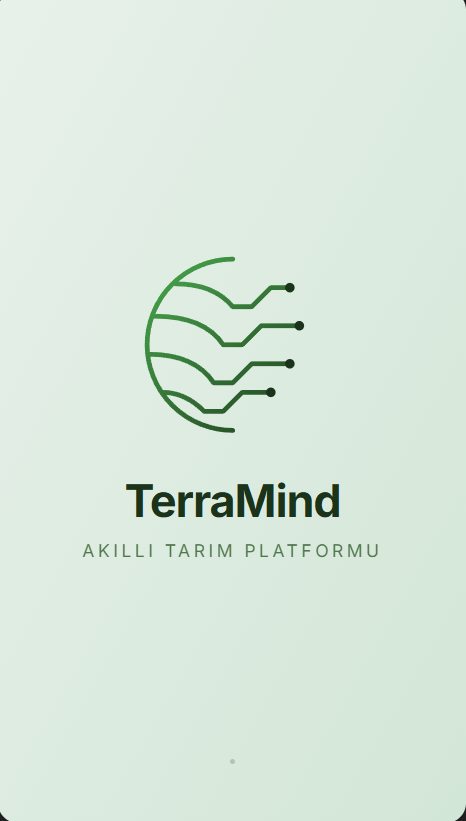
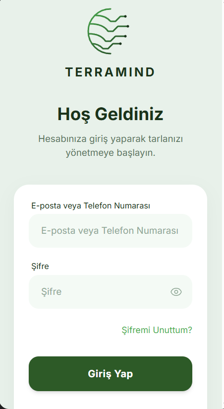
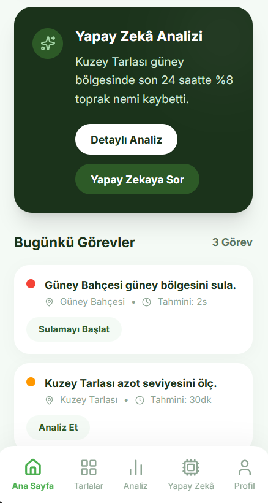
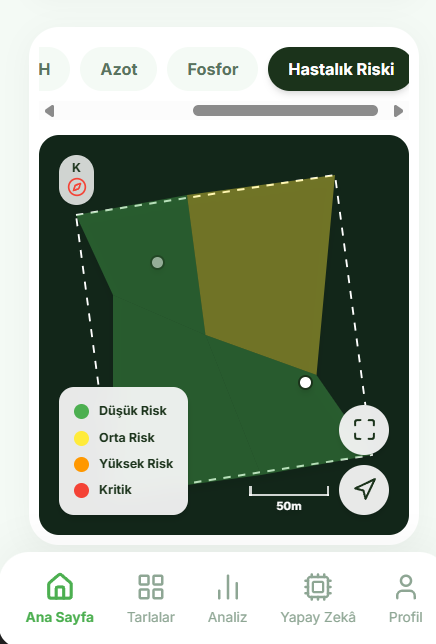
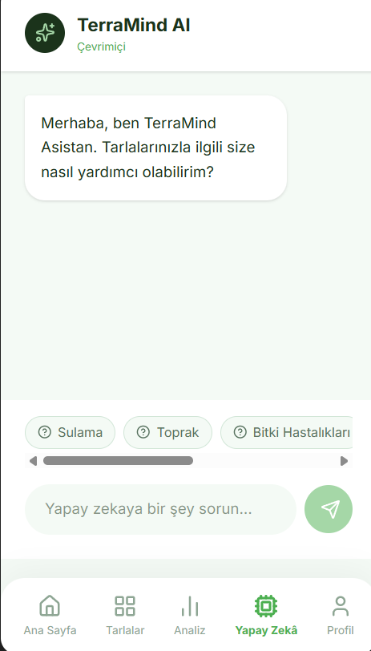
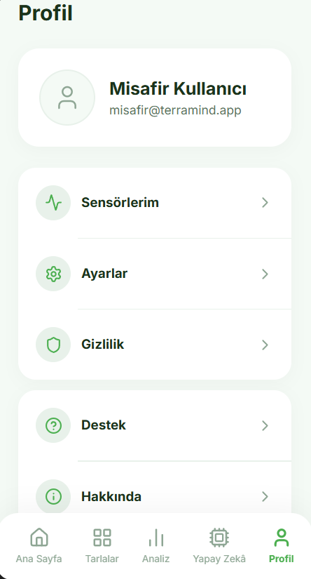
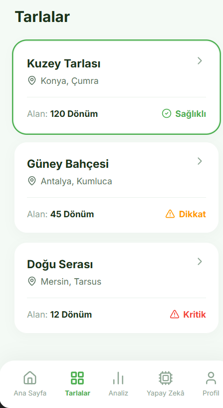

<div align="center">


# 🌱 TerraMind

### Akıllı Tarım Platformu & Gelişmiş Simülasyon Merkezi

### **Veri • Zekâ • Verim**

Toprağı anlayan, verileri analiz eden ve üreticiye doğru zamanda doğru kararı vermesinde yardımcı olan yapay zekâ destekli dijital tarım platformu. 
Ayrıca TerraMind; arka planda jüri, test ve mühendislik süreçleri için 30'dan fazla senaryoyu canlı çalıştırabilen bağımsız bir **Simülasyon Kontrol Merkezi** içerir.

🚧 **Proje aktif olarak geliştirilmektedir.**

---


</div>

---

# 📖 Proje Hakkında

TerraMind; sensörler, yapay zekâ ve veri analizi teknolojilerini tek platform altında birleştirerek tarımsal üretimi daha verimli, sürdürülebilir ve öngörülebilir hale getirmeyi amaçlayan akıllı tarım platformudur.

Platform, yalnızca verileri göstermek yerine üreticiye **"Şu anda ne oluyor?"**, **"Neden oluyor?"** ve **"Şimdi ne yapmalıyım?"** sorularının cevaplarını sunmayı hedeflemektedir.

---

# 📱 Uygulama Görselleri

## Splash Screen • Giriş Yap • Ana Sayfa

<p align="center">



</p>

---

## Uydu Haritası • Yapay Zekâ • Profil

<p align="center">



</p>

---

## Tarlalar

<p align="center">

</p>

---

# 🚀 Özellikler

### 🌾 Tarla Yönetimi
- Çoklu tarla desteği
- Tarla sağlık skoru
- Tarla bazlı analiz
- Bölgesel durum takibi

### 🛰️ Akıllı Harita
- Uydu görüntüsü
- Dijital tarla haritası
- Bölgesel analiz
- Katman sistemi

### 📊 Toprak Analizi
- Toprak Nemi
- Su Durumu
- pH, Azot, Fosfor (NPK)
- Hastalık Riski
- FAO-56 referans evapotranspirasyon (ET0) tabanlı su açığı modeli.

### 🤖 Yapay Zekâ
- Tarımsal öneriler
- Günlük analiz
- Yapay zekâ sohbet sistemi
- Sensör verilerine göre yorumlama (XAI)

### 🎛️ Simülasyon ve Kontrol Merkezi (Admin Paneli)
- 30 farklı tarımsal senaryonun (Kuraklık, Sel, Don, Sensör Arızası vb.) canlı tetiklenmesi.
- Ana sisteme gerçek zamanlı (SSE) olarak veri basabilme.
- İklim, NPK, Nem ve Sulama vanalarının anlık simüle edilmesi.
- Bilimsel hesaplama motorunun formüllerini ve API loglarını anlık izleme.

### 🌦️ Hava Durumu
- Koordinat tabanlı otomatik konum tanıma.
- Tarımsal hava tahmin raporları (MGM Benzeri yapı).
- Sulama, İlaçlama ve Don riski hesaplamaları.

---

# 🛠️ Kullanılan Teknolojiler

| Teknoloji | Açıklama |
|-----------|----------|
| React | Frontend ve Admin Paneli Arayüzü |
| TypeScript | Tip Güvenliği ve Temiz Kod |
| Node.js / Express | Gerçek Zamanlı Veri ve Analiz API'leri |
| Server-Sent Events (SSE) | Frontend ve Admin Arasındaki Canlı Veri Akışı |
| Tailwind CSS | Tasarım ve Stillendirme |
| Recharts / Leaflet | Grafikler ve Akıllı Harita |

---

# 💻 Kurulum ve Çalıştırma

Proje **Üç Ana Bileşenden** oluşmaktadır: **Ön Yüz (Frontend)**, **Arka Yüz (Backend)** ve **Kontrol Merkezi (Admin)**. Uygulamanın tüm özelliklerini (özellikle Senaryo Laboratuvarı ve Simülasyon modlarını) test edebilmek için üçünün de aynı anda çalıştırılması gerekmektedir.

### 1. Arka Yüzü (Backend) Başlatmak
Backend, SSE üzerinden Admin panelindeki simülasyonları ana platforma bağlar ve FAO-56 / GDD hesaplamalarını yürütür.
Yeni bir terminal açın:
```bash
cd backend
npm install
npm run dev
```
*(Sunucu 5000 portunda çalışacaktır)*

### 2. Çiftçi Platformunu (Frontend) Başlatmak
Çiftçinin / Kullanıcının göreceği ana uygulama (TerraMind).
Yeni bir terminal açın:
```bash
cd frontend
npm install
npm run dev
```
*(Sunucu 3000 portunda çalışacaktır)*

### 3. Simülasyon ve Kontrol Merkezini (Admin) Başlatmak
Projeyi sunarken arka planda tarımsal olayları (Kuraklık, sulama hatası vs.) canlı tetiklemek için kullanılan özel panel.
Yeni bir terminal açın:
```bash
cd admin
npm install
npm run dev
```
*(Sunucu 3001 portunda çalışacaktır)*

> **Not:** Admin panelinden "Şiddetli Kuraklık" veya "Sensör Arızası" gibi bir senaryo tetiklediğinizde, `http://localhost:3000` adresindeki Frontend'de anında kırmızı alarmlar, rozetler (🟠 SİMÜLASYON OVERRIDE) ve uyarılar belirecektir.

---

# 📈 Geliştirme Durumu

Projede arayüz bileşenlerinin (UI) tamamı kodlanmış ve temel arka uç (backend) analiz API'leri, gelişmiş bir Simülasyon Paneliyle devreye alınmıştır.

| Modül | Durum | Açıklama |
|--------|:----:|---|
| **Kullanıcı Deneyimi (UI/UX)** | | |
| Splash Screen & Auth | ✅ | Giriş ve kayıt arayüzleri tamamlandı. |
| Ana Sayfa (Dashboard) | ✅ | Dinamik kartlar ve genel bakış aktif. |
| Uydu Haritası | ✅ | Leaflet.js entegrasyonları hazır. |
| Yapay Zekâ & Chat | ✅ | AI tahmin zaman çizelgesi ve XAI (Açıklanabilirlik) eklendi. |
| Tarlalar | ✅ | Tarla ekleme ve koordinat bazlı algılama aktif. |
| **Analiz & Veri** | | |
| Toprak & Su Analizi | ✅ | FAO-56 su dengesi hesaplamaları aktif. |
| İklim & Güneş (GDD) | ✅ | Gelişim Derece Günleri (GDD) hesaplamaları aktif. |
| Hava Durumu | ✅ | Koordinat bazlı Open-Meteo simülasyonları tamamlandı. |
| **Simülasyon & Yönetim (Admin)** | | |
| 30+ Tarımsal Senaryo | ✅ | Kuraklık, Su Stresi, NPK Eksikliği, Sensör Kopması (Offline) aktif. |
| Bilimsel Motor & API İzleme | ✅ | Formüller ve canlı sistem logları panele eklendi. |
| Jüri Demo Modu | ✅ | Adım adım otomatik senaryo ve hikaye canlandırma sistemi hazır. |
| **Arka Plan (Backend)** | | |
| Live Sync (SSE) | ✅ | Admin'den Frontend'e milisaniyelik gecikmesiz senkronizasyon sağlandı. |
| Dinamik Override Motoru | ✅ | Sahte mock data yerine algoritma içi dinamik override sistemi kuruldu. |

---

# 📂 Proje Yapısı

```text
AI-Smart-Farming
│
├── admin/       # Gelişmiş Simülasyon ve Kontrol Merkezi (React)
├── backend/     # Hesaplama Motoru, API'ler ve SSE Sunucusu (Node/Express)
├── frontend/    # Çiftçi Uygulaması ve Ana Platform (React/Vite)
├── design/      # Tasarım dosyaları, ekran görüntüleri ve logolar
└── README.md    # Proje Dokümantasyonu
```

---

# 🌍 Gelecek Hedefleri

- 🌱 Gerçek donanım (ESP32) sensör entegrasyonu (Simülasyondan gerçeğe geçiş).
- ☁️ Bulut tabanlı veri yönetimi (Firebase / Supabase).
- 🤖 Gelişmiş yapay zekâ LLM (GPT/Gemini) karar sistemi.
- 📱 Mobil uygulama (React Native).
- 🚜 Otonom tarım araçları entegrasyonu.

---

# 🤝 Katkıda Bulunma

TerraMind aktif olarak geliştirilmektedir. Her türlü öneri, geri bildirim ve katkı projeyi daha ileri taşımamıza yardımcı olacaktır.

---

<div align="center">

## 🌱 TerraMind

### **Veri • Zekâ • Verim**

*"Toprağı anlayan teknoloji, geleceği şekillendirir."*

⭐ Projeyi beğendiysen yıldız vermeyi unutma.

</div>