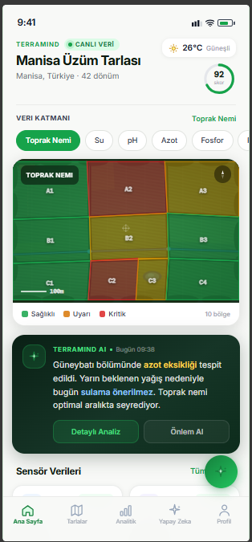
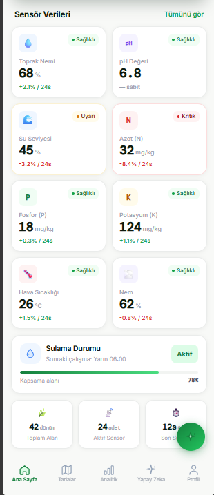

<div align="center">

# 🌱 TerraMind

### **Veri • Zekâ • Verim**

**Toprağı Anlayan, Geleceği Planlayan Akıllı Tarım Ekosistemi**

---

TerraMind; sensörler, yapay zekâ ve veri analizi teknolojilerini bir araya getirerek tarımsal üretimi daha verimli, sürdürülebilir ve öngörülebilir hâle getirmeyi amaçlayan açık bir akıllı tarım ekosistemidir.

🚧 **Proje aktif olarak geliştirilmektedir.**

</div>

---

# 🎯 Neden TerraMind?

Tarım, insanlığın en temel yaşam kaynaklarından biridir.

Ancak günümüzde üreticiler;

- 🌍 İklim değişikliği
- 💧 Su kaynaklarının azalması
- 💰 Artan üretim maliyetleri
- 📉 Verimsiz kaynak kullanımı
- 🌾 Geleneksel üretim yöntemleri

gibi birçok problemle karşı karşıyadır.

TerraMind, bu problemlere **gerçek zamanlı veriler** ve **yapay zekâ destekli analizler** ile çözüm üretmeyi hedeflemektedir.

---

# 🚀 TerraMind Ne Sunmayı Hedefliyor?

- 🛰️ Tarlanın anlık durumunu uzaktan takip edebilme
- 🌱 Toprak verilerinin detaylı analiz edilmesi
- 🤖 Yapay zekâ destekli karar önerileri
- 💧 Akıllı sulama desteği
- 🧪 Gübreleme ve mineral takibi
- 📊 Veriye dayalı üretim planlaması
- 🚜 Gelecekte otonom tarım sistemleriyle entegrasyon

---

# 🌍 Vizyon

TerraMind'ın vizyonu; tarımın yalnızca daha verimli değil, aynı zamanda daha akıllı, daha sürdürülebilir ve daha erişilebilir olduğu bir geleceğin oluşmasına katkı sağlamaktır.

Uzun vadede TerraMind; sensörler, yapay zekâ, veri analizi ve otonom sistemleri tek platform altında birleştiren kapsamlı bir dijital tarım ekosistemine dönüşmeyi hedeflemektedir.

---

# 📱 v0.1 Beta

İlk beta sürümünde çalışmalar ağırlıklı olarak kullanıcı deneyimi ve temel sistem tasarımı üzerine yoğunlaşmaktadır.

### Bu sürümde bulunan özellikler

- 🗺️ Dijital tarla haritası
- 🌾 Genel tarla sağlık durumu
- 🤖 Yapay zekâ öneri paneli
- 📊 Toprak analiz kartları
- 💧 Veri katmanları (Nem, Su, pH, Azot vb.)

---

# 🖼️ Arayüz

### Ana Ekran



### Ana Ekran (Devam)



---

# 📈 Geliştirme Durumu

| Özellik | Durum |
|---------|:-----:|
| Manifesto | ✅ |
| Vizyon | ✅ |
| Problem Tanımı | ✅ |
| Ana ekran tasarımı | ✅ |
| Tarlalar sayfası | ⏳ |
| Yapay zekâ asistanı | ⏳ |
| Analiz ekranı | ⏳ |
| Backend altyapısı | ⏳ |
| Sensör entegrasyonu | ⏳ |
| Gerçek zamanlı veri akışı | ⏳ |

---

# 🛣️ Yol Haritası

### v0.1

- Proje vizyonunun oluşturulması
- İlk kullanıcı arayüzü
- Dokümantasyon altyapısı

### v0.2

- Tarlalar sayfası
- Analiz ekranı
- Yapay zekâ asistanı

### v0.3

- Sensör entegrasyonu
- Backend geliştirmeleri
- Gerçek zamanlı veri yönetimi

### v1.0

- Yapay zekâ destekli karar sistemi
- Akıllı sulama
- Mobil uygulama
- İlk saha testleri

---

# 📂 Proje Yapısı

```text
AI-Smart-Farming/

├── backend/      # Sunucu tarafı
├── design/       # Tasarımlar ve ekran görüntüleri
├── docs/         # Dokümantasyon
├── frontend/     # Kullanıcı arayüzü
├── hardware/     # Sensör ve donanım çalışmaları
└── tests/        # Testler
```

---

# 🔮 Gelecek Hedefleri

- 🌱 Gerçek sensör entegrasyonu
- 📱 Mobil uygulama
- 🤖 Gelişmiş yapay zekâ asistanı
- 💧 Akıllı sulama otomasyonu
- 🚜 Otonom tarım araçları entegrasyonu
- 🌍 Küresel ölçekte kullanılabilecek dijital tarım ekosistemi

---

# 🤝 Katkıda Bulunma

TerraMind aktif olarak geliştirilmektedir.

Projeyle ilgili fikirler, öneriler ve geri bildirimler her zaman değerlidir. Her katkı, TerraMind'ın daha güçlü bir ekosistem olmasına katkı sağlar.

---

<div align="center">

## 🌱 TerraMind

### **Veri • Zekâ • Verim**

*"Toprağı anlamadan geleceği inşa edemezsiniz."*

</div>